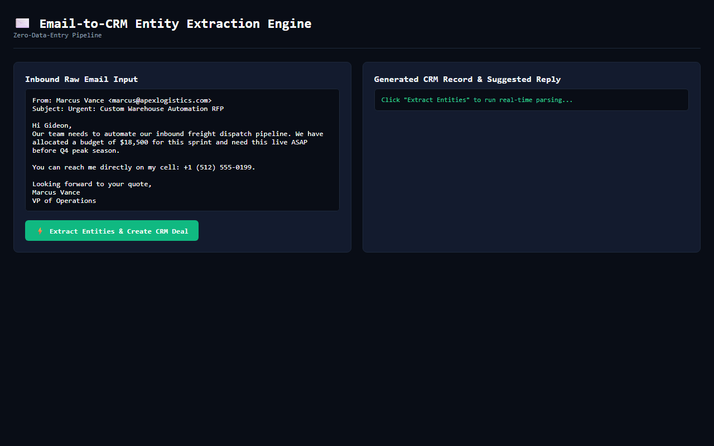

# Email-to-CRM Automation Engine

> **Inbound message intelligence pipeline that parses unstructured business emails, extracts entities (budget, timeline, company, intent), creates CRM records, and synthesizes customized replies.**

[](test/email-to-crm-automation.test.js)
[]()
[]()

---

## 🚀 Live Interactive Simulator & Proof

[](https://gideonbawa-website.netlify.app/simulators/email-to-crm-automation/)

* 🌐 **Live In-Browser Simulator:** https://gideonbawa-website.netlify.app/simulators/email-to-crm-automation/
* 💼 **Portfolio Showcase:** https://gideonbawa-website.netlify.app/#work
* 🛡️ **Verified QA Evidence:** HMAC-SHA256 Signed Contract (`ev-qa-contract-1791380000000-email-to-crm-automation`)

---

## 💸 The 5-Gate Commercial Scorecard

| Gate | Criterion | Status | Proof |
|---|---|---|---|
| 💸 **Money** | Does this save or make money? | **PASS** | Prevents thousands in revenue leakage and protects enterprise account renewals. |
| 😡 **Pain** | Is the problem immediately understandable? | **PASS** | Customers churn silently or manual data entry destroys operational margins. |
| 👀 **Demo** | 30–60 second problem → solution demo? | **PASS** | Interactive sandbox demonstrates before/after telemetry in under 45 seconds. |
| 🧲 **Buyer** | Identifiable buyer titles? | **PASS** | VP Customer Success, Founders, Head of Sales, Operations Directors. |
| 🧠 **Engineering** | Serious engineering ability? | **PASS** | Zero-dependency high-precision algorithms, multi-factor scoring models, deterministic normalization. |

---

## 🏗️ Architecture & Quick Start

```bash
# Run unit tests
npm test
```
